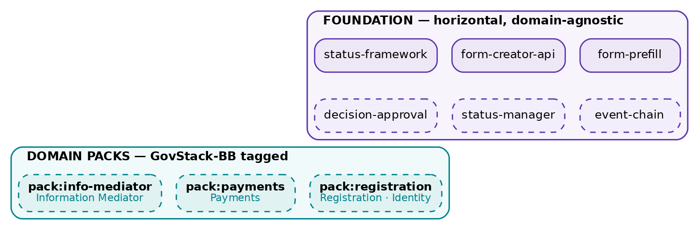

# joget-platform-plugins

Reusable, project-neutral **Joget DX OSGi plugins**, published as versioned artifacts and
consumed by projects — and by [`joget-spec-kit`](https://github.com/aarelaponin/joget-spec-kit) —
by **version pin, never by copy**. These are extensions of the Joget development platform,
not components of any one project.

This is the shared runtime-extension library for **any spec-to-code-on-Joget development** —
it is not GovStack-specific. Plugins are organised by capability: **foundation** (horizontal,
domain-agnostic) and **domain packs** (`pack:<domain>`). GovStack Building Blocks are an optional
tagging vocabulary on the packs that align to one, not the organising axis. See
`docs/CONSOLIDATION-PLAN.md` for the taxonomy and roadmap.

## The invariant

> **A plugin here NEVER depends on a consuming project.**

Projects (and the kit) depend on these plugins; the arrow only points one way. The moment a
plugin imports project code, it is disqualified — it goes back into the project until it is
genericised. This is the same one-way dependency rule that protects `joget-spec-kit`, applied
to the runtime layer. It is what turns reuse into *pin a version* instead of *copy and diverge*.

## Repo shape

```
pom.xml                     # parent (multi-module reactor; shared versions; GH Packages dist)
registry.yaml               # single source of truth: every plugin + its config contract
docs/
  registry.schema.yaml      # schema for registry entries
  CONSOLIDATION-PLAN.md     # THE program plan: phases, status, roadmap, decisions
  MIGRATION-BACKLOG.md      # what moves here, in what order, with provenance rules
  DAS-EXTRACTION-PLAN.md    # how the trapped approval service comes out of cmbb-plugins
plugins/
  joget-form-prefill/       # module 1 (active) — config-only form prefill binder
  ...                       # further modules as promoted
```

## Consume a plugin (from a project or the kit)

Pin the artifact; do not vendor the JAR:

```xml
<dependency>
  <groupId>com.fiscaladmin.joget</groupId>
  <artifactId>joget-form-prefill</artifactId>
  <version>1.0.0</version>
  <scope>provided</scope>   <!-- deployed to the instance, not embedded in the app -->
</dependency>
```

At deploy time the pinned JAR is dropped into `<joget>/wflow/app_plugins/` (hot-reload ~10s)
or uploaded via Manage Plugins. `joget-spec-kit`'s `deploy` step resolves the pins and does
this; it reads `registry.yaml` to know which plugins exist and how to configure them.

## Placing the jars

A plugin folder (`wflow/app_plugins`) installs the jars put in it **in the alphabetical order of their file names**, and a bundle that imports a package another bundle of the library exports does not resolve if it is installed first: the instance answers *Unable to resolve ... missing requirement ... osgi.wiring.package=...* and leaves the bundle not started. Placed together, a consumer whose name sorts before `joget-event-chain` or `joget-status-manager` can be installed before the bundle it imports (MT-DM's placing of 9 November 2026: `joget-case-ops` and `joget-decision-approval` failed this way and started only when touched again).

So place the library bundles first and their consumers after them (wait until the plugin list shows a layer started), **or** place them all and restart the instance once; touching a failed jar again (a new modification time, the bytes unchanged) had the plugin manager install it again and start it, in MT-DM's placing.

The order below is read by `placing_order.py` from each plugin's manifest and pom (a plugin depends on another when it imports a package the other exports), not written by hand. Each layer may be placed together; place a layer after the one before it has started.

| Layer | Jars | Imports of the library's own packages |
|---|---|---|
| 1 | `joget-event-chain-2.1.0.jar` | none |
| 1 | `joget-form-prefill-1.1.1.jar` | none |
| 1 | `joget-require-guard-1.0.0.jar` | none |
| 1 | `joget-tenant-1.0.0.jar` | none |
| 1 | `joget-unique-guard-1.0.0.jar` | none |
| 2 | `joget-sla-1.2.0.jar` | com.fiscaladmin.joget.eventchain (joget-event-chain) |
| 2 | `joget-status-manager-2.1.0.jar` | com.fiscaladmin.joget.eventchain (joget-event-chain) |
| 3 | `joget-case-ops-1.2.0.jar` | com.fiscaladmin.joget.eventchain (joget-event-chain); com.fiscaladmin.joget.statusmanager (joget-status-manager) |
| 3 | `joget-decision-approval-1.6.1.jar` | com.fiscaladmin.joget.eventchain (joget-event-chain); com.fiscaladmin.joget.statusmanager (joget-status-manager) |
| 3 | `joget-transition-guard-1.11.0.jar` | com.fiscaladmin.joget.eventchain (joget-event-chain); com.fiscaladmin.joget.statusmanager (joget-status-manager) |

Sorting by name alone puts these before a bundle they import: `joget-case-ops-1.2.0.jar` before `joget-event-chain-2.1.0.jar`, `joget-status-manager-2.1.0.jar`; `joget-decision-approval-1.6.1.jar` before `joget-event-chain-2.1.0.jar`, `joget-status-manager-2.1.0.jar`.

A jar of a version other than the one named here is placed by the same rule: by its bundle, first the bundles that import nothing of the library, then those that import them.

**Reading which versions stand.** Four bundles of this library run on an instance and are named by neither Manage Plugins nor `listInstalledBundle`: `joget-event-chain` and `joget-status-manager`, which other plugins import, and `joget-case-ops` and `joget-sla`, which carry no plugin class (MT-DM's question of 9 November 2026, put to jdx10). That is the platform's design, not a fault of the jars. The platform lists a *plugin*, and a plugin is a service a bundle registers that implements `org.joget.plugin.base.Plugin`: `PluginManager.loadOsgiPlugins` walks the registered services of every installed bundle (`Bundle.getRegisteredServices`) and keeps only those that are an `instanceof Plugin`, and `listOsgiPlugin` returns them keyed by `Plugin.getName()` (read with `javap -c` from `PluginManager.class` in `wflow-plugin-base-8.1-SNAPSHOT.jar` on 9 November 2026; the 9.0.7 installation's own class, the console's listing page and `listInstalledBundle` were not read in that round). A bundle that registers no `Plugin` service has nothing in that collection, however well it runs, and none of the four registers a service: each exports a package of classes for other bundles to import and has no `Bundle-Activator` and no class that extends a plugin base (their manifests, built on 9 November 2026: `Bundle-Version` 2.1.0, 2.1.0, 1.2.0 and 1.2.0, no `Bundle-Activator`). No plugin class is added to name them: it would make a library a plugin only to be listed, with a name, a label and a place of its own in the plugin lists. Read the versions that stand from the jars instead, in three places that agree: the jar names in `<joget>/wflow/app_plugins` (artifact and version, as in the table above); the lines `joget.log` writes as each bundle starts (MT-DM read all four as started on jdx10); and the `Bundle-Version` in each jar's `META-INF/MANIFEST.MF`, which the build sets from the pom.


## Build & publish

Builds run on a workstation with JDK + Maven (the Cowork sandbox has no Maven).

```bash
mvn -q -pl plugins/<module> -am clean install     # build + test + install to ~/.m2 (local proof)
mvn -q -pl plugins/<module> -am deploy             # publish to GitHub Packages (needs a token)
```

Publishing to **GitHub Packages** needs a Personal Access Token (`write:packages`) in
`~/.m2/settings.xml` under server id `github`. Credentials live there, never in this repo.

## Versioning & the config contract

Semver per plugin. A plugin's **config contract** (the property/element keys in its
`registry.yaml` entry) is its public API — the surface `joget-spec-kit` generates against
*without compiling the plugin*. Changing a contract key is a **major** bump; adding an
optional one is minor; a bug fix is a patch. `dx_compat` records DX 8.x / 9.x support.

## Governance (so it does not rot back into duplication)

- **One home.** A plugin lives here and only here. Projects pin it; they never fork or vendor it.
- **Promote, don't copy.** When a second project needs a plugin, promote it here and pin — never
  paste it into the second project.
- **Provenance scrub before promotion.** No client names (see MIGRATION-BACKLOG §Provenance) in
  shipped code, comments, samples or resources. Test fixtures may use domain-generic field names.
- **Registry ↔ build drift check.** CI asserts every `status: active` entry maps to a built
  module and vice-versa (the `joget-claude-skills` MANIFEST drift is the cautionary tale).

## Relationship to the other repos

```
joget-claude-skills   → the authoring method (how a human/agent builds)
joget-spec-kit (jkit) → the how-to-build engine (spec → artefacts); reads registry.yaml
joget-platform-plugins→ THIS repo — the runtime extensions (the JARs Joget loads)
project repos         → depend on all three by version pin; own only their app model + assets
```

## Documentation & vision

Start with the **[Vision](docs/VISION.md)** — why plugins become a platform, what it is, and how
it works, with diagrams. The [`docs/`](docs/) folder is the home for all canonical documents
(Markdown, rendered on GitHub with figures); see [docs/README.md](docs/README.md) for the index and
the convention (polished DOCX/PDF are published as GitHub Release assets, not committed).



*Foundation (horizontal) + Domain packs (GovStack-BB tagged). Solid = shipped; dashed = planned.*
